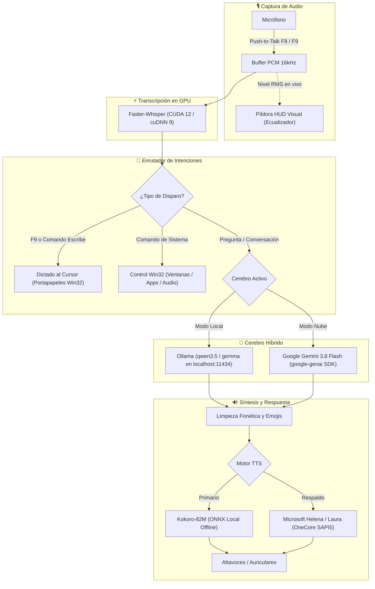

# 🎙️ Biktus — Asistente de Voz Local, Privado e Híbrido

<p align="center">
  
  
  
  
  
  
  
</p>

---

**Biktus** es un asistente de control por voz privado, inteligente y ultrarrápido para **Windows 11**, optimizado especialmente para funcionar en local sobre GPUs **NVIDIA GeForce RTX (CUDA 12)** y compatible con fallback en CPU.

Combina:
- **Transcripción Neuronal Local** con `faster-whisper` en VRAM (~200-300 ms).
- **Voz Neuronal Offline de Alta Fidelidad** con `Kokoro-82M` (ONNX).
- **Cerebro Híbrido Dual:** Inteligencia local 100% desconectada con **Ollama** (`qwen3.5:9b`, `gemma`, etc.) o razonamiento en la nube con **Google Gemini 3.8 Flash**.
- **Píldora Visual HUD Reactiva:** Interfaz flotante translúcida moderna (Fluent / Windows 11) con ecualizador de voz dinámico que no roba el foco de tus ventanas activas.
- **Automatización Nativa Win32:** Control real de ventanas con bypass del *Foreground Lock Timeout* de Windows, dictado directo al cursor con conversión ortográfica y control multimedia.

---

## 📐 Arquitectura del Sistema



---

## ⚡ Características Principales

- **Transcripción Ultrarrápida en GPU:** Inferencia en ~200-300 ms directamente en la VRAM de tu GPU NVIDIA usando FP16 o INT8.
- **Dictado Directo al Cursor (`F9`):** Mantén presionada `F9`, habla lo que quieras y al soltar la tecla el texto aparecerá al instante donde esté parpadeando el cursor (Word, VS Code, Slack, navegador, etc.). Incluye sustitución de puntuación hablada (*coma*, *punto*, *punto y aparte*, *nueva línea*, *dos puntos*).
- **HUD Flotante Reactivo:** Píldora visual elegante sin bordes, con esquinas redondeadas y animación de espectro de sonido reactiva en tiempo real. 100% silencioso (sin pitidos intrusivos) y diseñado para nunca robar el foco de escritura.
- **Control Real de Ventanas (Bypass de Foco Win32):** Resuelve el problema clásico de Windows donde `SetForegroundWindow` hace parpadear la barra de tareas en amarillo en lugar de traer la ventana al frente (`AttachThreadInput` + `SystemParametersInfo`).
- **Control Integrado para Herramientas de Desarrollo:** Comandos dedicados para abrir, cerrar y traer al frente **Antigravity 2.0** y **Antigravity IDE**.
- **Cerebro Híbrido Conmutable al Vuelo:**
  - *"Activar modo nube"* ➔ Conecta a Gemini 3.8 Flash para tareas complejas o con acceso a información actualizada.
  - *"Activar modo local"* ➔ Desconecta internet y procesa 100% en privado con Ollama.

---

## 📋 Requisitos del Sistema

- **Sistema Operativo:** Windows 10 / Windows 11 (64-bit).
- **Procesador / GPU:** 
  - Recomendado: GPU NVIDIA RTX (serie 30xx, 40xx o superior) con soporte CUDA 12.
  - Mínimo: CPU multi-núcleo (funciona con fallback `device="cpu"` y `compute_type="int8"`).
- **Python:** Python 3.11 o 3.12 (o el gestor de paquetes ultrarrápido [uv](https://github.com/astral-sh/uv)).
- **Ollama (para modo local):** Instalado desde [ollama.com](https://ollama.com/).
- **Clave API de Google Gemini (opcional, para modo nube):** Obtenible gratis en [Google AI Studio](https://aistudio.google.com/).

---

## 🚀 Instalación Paso a Paso

### 1. Clonar el Repositorio

```bash
git clone https://github.com/TU_USUARIO/asisitente-voz-hybrido.git
cd asisitente-voz-hybrido
```

### 2. Instalar Dependencias del Entorno

Se recomienda usar **[uv](https://github.com/astral-sh/uv)** por su rapidez y gestión automática de paquetes CUDA:

```bash
# Con uv (Recomendado):
uv sync

# O con pip tradicional en tu entorno virtual:
python -m venv .venv
.venv\Scripts\activate
pip install -r pyproject.toml
```

> **Nota para aceleración CUDA en Windows:** `pyproject.toml` ya incluye `nvidia-cublas-cu12` y `nvidia-cudnn-cu12`. El asistente detecta y añade automáticamente sus bibliotecas al PATH de Windows en el arranque.

### 3. Descargar los Modelos Neuronales de Kokoro TTS

Los archivos pesados de pesos neuronales ONNX (`~326 MB`) no se incluyen en el repositorio Git. Ejecuta el script automatizado para descargarlos:

```bash
uv run python descargar_modelos.py
# o: python descargar_modelos.py
```

Esto descargará en la carpeta `models/kokoro/`:
- `kokoro-v1.0.onnx`
- `voices-v1.0.bin`

*(Si prefieres no descargarlos, el asistente funcionará igualmente usando las voces nativas de Windows OneCore SAPI5 como fallback).*

### 4. Configurar el Modelo Local (Ollama)

Asegúrate de que Ollama esté ejecutándose y descarga tu modelo de preferencia:

```bash
ollama run qwen3.5:9b
```

### 5. Configurar `config.json`

Copia la plantilla de configuración:

```bash
copy config.example.json config.json
```

Edita `config.json` según tus preferencias:

```json
{
  "hotkey": "f8",
  "dictation_hotkey": "f9",
  "modo_activacion": "push_to_talk",
  "whisper_model": "small",
  "device": "cuda",
  "compute_type": "float16",
  "language": "es",
  "hud_visual": true,
  "sonido_pitido": false,
  "ollama_url": "http://127.0.0.1:11434/api/generate",
  "ollama_model": "qwen3.5:9b",
  "brain_mode": "local",
  "gemini_api_key": "TU_API_KEY_DE_GEMINI_AQUI",
  "gemini_model": "gemini-3.8-flash",
  "tts_engine": "kokoro",
  "tts_voice": "ef_dora",
  "tts_speed": 1.05,
  "tts_volume": 1.0,
  "assistant_name": "Biktus",
  "user_name": "Jimmy",
  "user_nickname": "Mochi"
}
```

---

## 🎮 Uso y Controles

### Inicio Rápido
Haz doble clic en:
```bat
INICIAR_ASISTENTE.bat
```

### Teclas de Acceso Rápido (Push-to-Talk)

| Tecla | Acción | Descripción |
| :--- | :--- | :--- |
| **`F8`** | **Asistente General** | Mantén pulsada para hablar comandos o preguntas. Al soltar, procesa y responde por voz. |
| **`F9`** | **Dictado al Cursor** | Mantén pulsada y habla. Al soltar, el texto se escribe directamente en la aplicación activa. |

### Inicio Automático con Windows (Opcional)
- Para que inicie automáticamente en segundo plano al encender el equipo: ejecuta `ACTIVAR_INICIO_AUTOMATICO.bat`.
- Para desactivar el inicio automático: ejecuta `DESACTIVAR_INICIO_AUTOMATICO.bat`.

---

## 🗣️ Catálogo de Comandos de Voz

### 💻 Aplicaciones y Entorno de Desarrollo
- *"Abrir Antigravity"* / *"Abre Antigravity 2.0"* ➔ Pasa Antigravity 2.0 al primer plano.
- *"Cerrar Antigravity"* / *"Cierra Antigravity 2.0"* ➔ Cierra Antigravity 2.0.
- *"Abrir Antigravity IDE"* / *"Abre el IDE"* ➔ Pasa Antigravity IDE al primer plano.
- *"Cerrar Antigravity IDE"* / *"Cierra el IDE"* ➔ Cierra Antigravity IDE.
- *"Abrir calculadora"* / *"Cerrar calculadora"*
- *"Abrir bloc de notas"* / *"Cerrar bloc de notas"*
- *"Abrir explorador"* / *"Cerrar explorador"*
- *"Administrador de tareas"* / *"Cerrar tareas"*
- *"Abrir configuración"*
- *"Abrir inicio"* / *"Menú de inicio"*

### 🪟 Ventanas y Navegación
- *"Cerrar ventana"* / *"Cierra el programa"* (`Alt + F4`)
- *"Cerrar pestaña"* (`Ctrl + W`)
- *"Minimizar todo"* / *"Mostrar escritorio"* (`Win + D`)
- *"Abrir Firefox"* / *"Abrir Chrome"* / *"Abrir Edge"*
- *"Abrir YouTube"* / *"Abrir Google"* / *"Abrir GitHub"*
- *"Busca en Google [tema]"*
- *"Busca en YouTube [tema]"*

### ✍️ Dictado y Modos de Texto
- **Tecla `F9` directa:** Escribe en el cursor todo lo que digas mientras mantienes la tecla.
- **Dictado puntual con `F8`:**
  - *"Escribe: [texto]"* o *"Dicta: [texto]"* ➔ Escribe en la ventana enfocada.
  - *"Escribe aquí: [texto]"* ➔ Clic izquierdo donde esté el ratón y escribe a continuación.
- **Modo continuo:**
  - *"Activar modo dictado"* ➔ Todo lo hablado se transcribirá al cursor sin responder por voz.
  - *"Desactivar modo dictado"* ➔ Vuelve al modo asistente normal.
- **Puntuación hablada:** Soporta *"coma"*, *"punto"*, *"punto y aparte"*, *"dos puntos"*, *"signo de interrogación"*, etc.

### 🔊 Sistema y Cerebro
- *"Subir volumen"* / *"Bajar volumen"* / *"Silenciar"*
- *"Qué hora es"* / *"Qué día es hoy"*
- *"Activar modo nube"* / *"Activar modo local"* / *"En qué modo estás"*
- *"Quién soy"* / *"Quién eres"*
- *"Cerrar asistente"* / *"Apagar asistente"*

---

## 📁 Estructura del Proyecto

```text
asisitente-voz-hybrido/
├── src/                          # Código fuente del paquete
├── models/
│   └── kokoro/                   # Pesos ONNX del modelo de voz Kokoro (excluidos de Git)
├── ollama/                       # Modelfiles y utilidades para Ollama
├── acciones.py                   # Automatización Win32, atajos de teclado y lanzadores
├── asistente.py                  # Bucle principal: audio, Faster-Whisper, cerebros y TTS
├── hud.py                        # Ventana flotante PyQt6 / Tkinter con ecualizador reactivo
├── descargar_modelos.py          # Script de descarga automática de modelos Kokoro TTS
├── config.example.json           # Plantilla pública de configuración
├── INICIAR_ASISTENTE.bat         # Lanzador rápido con detección de entorno
├── ACTIVAR_INICIO_AUTOMATICO.bat # Instalador de acceso directo en Startup de Windows
├── DESACTIVAR_INICIO_AUTOMATICO.bat # Desinstalador del inicio automático
├── pyproject.toml                # Metadatos del proyecto y dependencias
└── .gitignore                    # Reglas de exclusión para Git (ignora claves y modelos)
```

---

## 🔒 Privacidad y Seguridad

- **100% Local por Defecto:** En modo local, ni el audio ni tus preguntas salen de tu ordenador.
- **Sin Claves en el Repositorio:** El archivo `.gitignore` excluye automáticamente `config.json`, logs de depuración (`asistente.log`), entornos virtuales (`.venv`) y los pesos pesados de modelos.

---

## 📄 Licencia

Distribuido bajo la Licencia **MIT**. Consulta `LICENSE` para más información.
